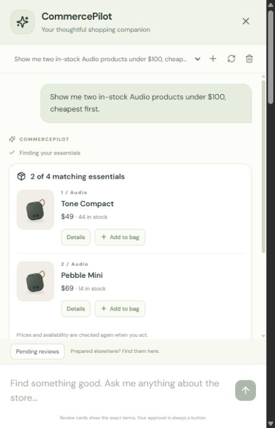
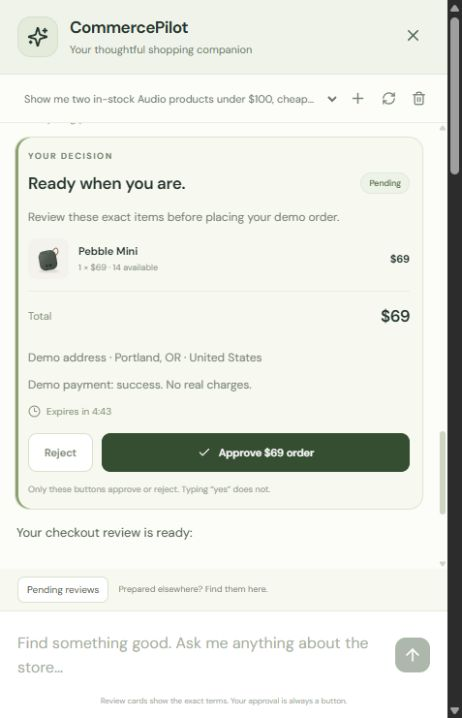
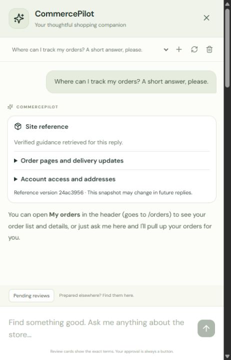

# CommercePilot

A local AI shopping assistant built with Next.js, ASP.NET Core, and the Model Context Protocol (MCP).

CommercePilot combines a working storefront with a persistent, streaming chat. Ask for products, refer to "the second one," update your bag, and review a checkout without leaving the conversation. The assistant calls real MCP tools against PostgreSQL; the application validates ownership, prices, stock and permissions before accepting a change.

Local models handle conversation and retrieval. Versioned site knowledge helps the assistant explain actual pages and supported features, with visible source cards. Checkout, cancellation and refund require an explicit **Approve** button; a message such as "yes" does not execute them. Products and specifications are fictional, and payments and delivery are simulated.

## In the chat

These screenshots show actual English conversations with the running local model and MCP server. Click an image to view it at its original size.

| Find products | Review before committing | Get grounded site guidance |
| --- | --- | --- |
| <a href="docs/images/chat-product-discovery.jpg"></a> | <a href="docs/images/chat-inline-approval.jpg"></a> | <a href="docs/images/chat-site-guidance.jpg"></a> |

The demonstrated flow searched the live catalog, resolved "the second one" to Pebble Mini, added it to the bag, and prepared the review shown above. The demo review was then rejected and the bag restored. The knowledge example retrieved the published site guide before answering.

## What you can do

- **Browse and shop:** search 32 demo products across Audio, Workspace, Everyday and Gaming; combine filters, inspect details and keep a persistent personal bag.
- **Use conversational references:** follow up with "add it" or "the second one." Ordered tool results and bounded conversation history provide the context; unclear references require clarification.
- **Review consequential changes:** inspect exact checkout, cancellation or refund terms in chat, then approve or reject with a button. Prices, stock and eligibility are checked again when you approve.
- **Track orders in either interface:** use chat or the dedicated `/orders` list and individual detail pages, including payment state and a simulated delivery timeline.
- **Ask about the site:** retrieve reviewed public guidance using local embeddings, with source excerpts, links and version information. Personal order and bag data still comes from authenticated tools.

## How it works

1. The browser sends your message through the same-origin Next.js gateway to the authenticated .NET API.
2. The API loads bounded conversation history and retrieves relevant published site guidance from PostgreSQL/pgvector using local EmbeddingGemma embeddings.
3. Qwen3.8 proposes a reply or tool calls. The API validates those calls and sends them through the real MCP SDK client to the MCP server, which checks the shopper's identity and scopes and invokes shared commerce services.
4. Tool results return to the model for its next response and become typed product, bag, order or review cards. Text and card events stream to the browser; conversation records persist in PostgreSQL.
5. A critical action stops at a review. Only the authenticated UI's approval endpoint can execute it after fresh validation. The model has no confirmation tool.

**MCP access, chat memory and RAG have separate jobs.** MCP exposes authorized live operations. Chat memory retains previous messages and actual tool results. RAG retrieves public site facts. The MCP server uses stateless HTTP requests; conversation continuity is implemented by the application and database.

| Layer | Technology |
| --- | --- |
| Storefront and chat | Next.js 16, React 19, TypeScript, authored CSS |
| API and business rules | ASP.NET Core / .NET 10, ASP.NET Core Identity |
| MCP transport | Official C# SDK, Streamable HTTP, scoped credentials and OAuth + PKCE for external clients |
| Persistence and retrieval | PostgreSQL 18, EF Core, pgvector, full-text and vector search |
| Local AI | Ollama, Qwen3.8 27B for conversation, EmbeddingGemma for embeddings |
| Local runtime | Docker Compose; Ollama on the host for GPU access |

[Run locally](#run-locally) · [Try an order](#try-an-order) · [Architecture](#architecture) · [MCP access](#mcp-access) · [Site knowledge](#site-knowledge-and-order-pages) · [Verification](#verification)

## Run locally

Install Docker Desktop with Linux containers and start it. From the repository root, run:

```powershell
powershell.exe -NoProfile -ExecutionPolicy Bypass -File .\scripts\start.ps1
```

The script generates a local database password and two unique demo passwords in the ignored `.env` file, builds the application, applies migrations, seeds missing catalog entries/accounts, and waits for readiness. Existing catalog and cart data are preserved. The first run downloads container images and dependencies.

Open **[localhost:3000](http://localhost:3000)**.

To view your locally generated sign-in credentials:

```powershell
powershell.exe -NoProfile -ExecutionPolicy Bypass -File .\scripts\demo-accounts.ps1
```

The accounts are `alex@commercepilot.local` and `sam@commercepilot.local`, with separate bags. Click **Sign in**, choose an account, and enter its local password. Open a product to add it to your bag. Refreshing the page, signing out and back in, or rebuilding the API preserves the bag. Quantities must be between 1 and 99 and cannot exceed current stock. A bag does not reserve inventory.

| Service | Address |
| --- | --- |
| Storefront | http://localhost:3000 |
| API readiness | http://localhost:5080/health/ready |
| API liveness | http://localhost:5080/health/live |
| Development OpenAPI document | http://localhost:5080/openapi/v1.json |
| PostgreSQL | localhost:5438 |
| MCP | http://127.0.0.1:5081/mcp |
| Ollama (Windows host) | http://127.0.0.1:11434 |

All published ports bind to loopback. This Compose configuration is for local development: it enables development OpenAPI and a single-instance migration/seed bootstrap. Do not expose it as a production deployment.

Without PowerShell, copy `.env.example` to `.env`, replace the database placeholder with a randomly generated **alphanumeric** password, and supply two distinct demo passwords (at least 12 characters with uppercase, lowercase, digits, and a symbol). Then run:

```sh
docker compose up --build -d
```

Stop the application while preserving catalog data:

```sh
docker compose down
```

Catalog browsing and the manual bag work without Ollama. For chat and site guidance, install [Ollama](https://ollama.com/download/windows), leave it running on the host, and run the following after starting the stack. The knowledge publishing command also requires the .NET 10 SDK.

```powershell
ollama pull qwen3.8:27b
ollama pull embeddinggemma:latest
powershell.exe -NoProfile -ExecutionPolicy Bypass -File .\scripts\knowledge.ps1 publish -Value "local-operator"
```

The models need downloading only once; the published knowledge index survives restarts. Qwen3.8 27B was evaluated on a 24 GB GPU; see [Local model probe](#local-model-probe) for memory and context settings. Compose starts the storefront, API, MCP and database together; the API reaches Ollama through `host.docker.internal:11434`. No cloud account or API key is needed. The storefront uses original vector illustrations. Google Fonts is optional, with system-font fallbacks.

## Try an order

1. Sign in, open **Ask CommercePilot**, and ask for products. Follow up with “Tell me about the second one” or “Add it to my bag.”
2. Ask “Prepare checkout for my bag.” For other demo outcomes, explicitly request a delayed or declined payment. Preparation creates a five-minute review without reserving inventory or executing payment.
3. Inspect the inline card's items, exact total, fictional destination and payment outcome. **Approve** executes the review; **Reject** leaves the bag untouched. Typing “yes” never approves it.
4. Click **Orders** in the header for the dedicated order list, then select an order to see its details. You can also ask “Show my orders” in chat. Order pages and saved chat order cards refresh every 15 seconds while visible. Successful payment moves to simulated dispatch after approximately two minutes, then delivery two minutes later; delayed payment completes after approximately 20 seconds.
5. Choose **Review cancellation** before dispatch or **Review refund** within 30 days after delivery. Each creates another inline review requiring its own approval. **Pending reviews** also retrieves reviews prepared by a console MCP client.

No card or personal address is collected. All orders use a fictional destination with zero shipping and tax. A declined payment produces a failed order, releases its reservation, and preserves the bag for a new review. Cancellation releases stock once and either voids a pending payment or refunds captured funds. A delivered-order refund returns the full captured demo amount but does not restock delivered goods. Partial refunds and physical returns are not supported.

If prices, available stock, bag contents, or order eligibility change, the approval is rejected and a new review is required. Expired, rejected, and superseded reviews cannot execute. Repeating a completed confirmation returns the same order without reserving stock or charging again. After a connection failure, refresh the review/status before retrying. The order history shows the most recent 100 orders.

## Architecture

```text
Browser -> Next.js same-origin gateways -> ASP.NET Core API
                                         -> Catalog / Cart / Order services
                                         -> EF Core / PostgreSQL
Demo scheduler -> Order service -> persisted payment / shipment transitions
MCP client -> ASP.NET Core MCP server -> Catalog / Cart / Order services -> PostgreSQL
Chat API -> Ollama (proposes tools) -> scoped MCP clients -> commerce tools
Chat API -> PostgreSQL (turns, events, cards); SSE -> browser
Chat API -> EmbeddingGemma -> PostgreSQL / pgvector (published site references)
Reviewed knowledge files -> operator CLI -> embeddings -> atomic index publication
```

| Directory | Responsibility |
| --- | --- |
| `web` | Responsive storefront, sign-in, bag, order pages, streaming chat and inline cards, same-origin gateways |
| `src/Commerce.AI` | Bounded local Ollama adapter, streamed text, tool schemas and response validation |
| `src/Commerce.Domain` | Product, cart, order, approval and timeline models |
| `src/Commerce.Application` | Catalog/cart/order contracts and input validation |
| `src/Commerce.Infrastructure` | EF Core persistence, Identity users, migrations, application services, demo seeds |
| `src/Commerce.Api` | Authenticated HTTP endpoints, CSRF validation, rate limiting, health checks |
| `src/Commerce.Mcp` | Streamable HTTP MCP endpoint with public catalog tools, scoped bag access, order reads and checkout reviews |
| `src/Commerce.Knowledge` | Reviewed document validation, local embeddings, atomic publication and hybrid retrieval |
| `knowledge` | Public site guidance, allowed links, source review fingerprints and publishing documentation |
| `tools/Commerce.McpProbe` | Console MCP client for discovery, catalog calls and optional local shopper login |
| `tools/commerce-agent` | TypeScript MCP client with direct catalog calls and a separate LangChain/Ollama catalog assistant |
| `tools/Commerce.ModelProbe` | Local model adapter probe and proposal-only evaluation runner |
| `tools/Commerce.Knowledge` | Operator CLI to review, validate, publish and query site knowledge |
| `tests/Commerce.IntegrationTests` | Real PostgreSQL tests for identity, ownership, approvals, stock concurrency and payment/order transitions |
| `scripts` | Local startup and running-application verification |

The API and MCP adapters validate catalog queries using the same application contract. Prices use `numeric(12,2)` with an explicit currency. Database constraints reject negative prices and stock, and refunds greater than captured funds. Search escapes SQL `LIKE` metacharacters; paging has a stable tie-breaker. The gateways allow only documented routes and methods and do not forward arbitrary upstream paths.

Cart mutations share an application service that obtains prices from the database. A PostgreSQL row lock on the authenticated owner serializes concurrent mutations, including the first addition to an empty bag. The API obtains the owner from the authenticated principal, not client-supplied IDs. Cart reads recalculate prices and availability; unavailable quantities are flagged for correction.

Order preparation saves a server-owned JSON snapshot and SHA-256 hash. A database trigger prevents rewriting its owner, terms, hash or expiry. Confirmation locks the owner and then product rows in a stable order, revalidates the snapshot, and commits the approval result, order, inventory, payment state and timeline in one transaction. The approval ID is the idempotency key. Order and payment states are separate. Persisted simulation deadlines survive restarts; background transitions use the same owner lock as cancellation and cannot revive cancelled payments. GET requests never approve or advance orders.

The simulator records local payment state in the same database transaction. It is not a payment-provider integration. There is no message broker or event publisher in this version.

## Sessions and request protection

ASP.NET Core Identity hashes passwords and issues an HttpOnly, SameSite=Strict session cookie with an eight-hour sliding expiration. Cookies require HTTPS outside Development; loopback HTTP is used for the local Compose demo. Every cookie-based HTTP API mutation, including sign-in, sign-out and MCP credential issuance, requires an identity-bound antiforgery token. MCP calls use a separate bearer credential with tool-specific scope checks. The web gateway additionally checks the browser Origin against `APP_ORIGIN` (default `http://localhost:3000`), limits forwarded routes/methods, and does not automatically retry mutations.

The login endpoint permits 20 attempts per minute per upstream IP, and Identity locks an account for five minutes after five failed password checks. The local gateway shares an upstream IP. A production deployment needs trusted proxy configuration and a suitable distributed rate-limit policy.

Data Protection keys persist in the local PostgreSQL database so rebuilding the API does not invalidate sessions. Keys are not separately encrypted at rest in this local configuration; protect them with a certificate or managed key service for a hosted deployment. Neither credentials nor session cookies are stored in browser localStorage. Account/cart responses disable caching.

## API

```http
GET /api/products?search=wireless&category=Audio&maxPrice=200&sort=price-asc&page=1&pageSize=12
GET /api/products/{id}
GET /api/categories
GET /api/auth/csrf
GET /api/auth/session
POST /api/auth/login
POST /api/auth/logout
POST /api/auth/mcp-token
POST /api/auth/mcp-cart-token
POST /api/auth/mcp-orders-token
POST /api/auth/mcp-checkout-token
POST /api/auth/mcp-actions-token
POST /api/auth/mcp-cancellation-token
POST /api/auth/mcp-refund-token
GET /api/cart
POST /api/cart/items
PUT /api/cart/items/{productId}
DELETE /api/cart/items/{productId}
GET /api/orders
GET /api/orders/{id}
GET /api/actions
GET /api/actions/{id}
POST /api/orders/prepare
POST /api/orders/{id}/prepare-cancellation
POST /api/orders/{id}/prepare-refund
POST /api/actions/{id}/confirm
POST /api/actions/{id}/reject
```

Supported filters: `search`, `category`, `minPrice`, `maxPrice`, `inStock`. Sort values: `featured`, `price-asc`, `price-desc`, `name`. Page size is limited to 48. Invalid filters return HTTP 400; missing product IDs return HTTP 404. API and database failures produce an explicit storefront error instead of fabricated fallback products.

## Development

### MCP access

For the Node.js/TypeScript client, see [TypeScript catalog assistant](tools/commerce-agent/README.md). It supports direct MCP calls and a separate LangChain/Ollama command that selects public catalog tools from natural-language questions. The storefront chat continues to use the .NET implementation.

MCP starts with the normal local stack. To rebuild it independently:

```powershell
docker compose up --build -d mcp
Invoke-RestMethod http://127.0.0.1:5081/health/ready
```

With the .NET 10 SDK installed, run the console client from the repository root:

```powershell
dotnet run --project tools/Commerce.McpProbe -- "wireless"
```

The client connects to `http://127.0.0.1:5081/mcp`, lists available tools and their input schemas (`tools/list`), and calls `search_products` (`tools/call`). It prints structured product data from PostgreSQL, including IDs, prices, stock and pagination. Replace `wireless` with another search term. No language model or Ollama installation is needed.

The server uses the official MCP C# SDK 2.2.0 with stateless Streamable HTTP. Public `search_products` accepts the same catalog filters and limits as the HTTP API. `get_product` reads one product by its real UUID. Invalid values and missing products return tool errors. Both interfaces reuse `ICatalogService` and the same database queries.

To read your personal bag through `get_cart`, use either local demo account:

```powershell
dotnet run --project tools/Commerce.McpProbe -- --cart alex
dotnet run --project tools/Commerce.McpProbe -- --cart sam
```

The client prompts for the account's existing local password without echoing it. It signs in through the API using cookies and CSRF, obtains a five-minute MCP credential, and sends it in the MCP HTTP Authorization header. Credentials stay in process memory and are never printed. The console closes its separate API session after issuance; this does not sign out the storefront. Use the demo-accounts script above if you need your local password. Do not put passwords or access tokens in command arguments.

`get_cart` has no public parameters: the server takes the owner from the verified principal. The `cart:read` scope is required for discovery and invocation. Anonymous clients discover `search_products` and `get_product`; a read credential also exposes `get_cart`. Guessing a hidden tool's name does not bypass authorization. Invalid, expired, tampered, wrong-audience or wrong-issuer credentials return HTTP 401. Deleted or locked accounts and changed security stamps are rejected on each request. The credential endpoints accept no caller-selected owner, audience or scope and require an authenticated session plus CSRF; they share a limit of 10 issuances per minute per user.

To inspect a product and add one unit to Alex's bag, copy a product ID from the search result. This example uses the seeded Forma Wireless ID:

```powershell
dotnet run --project tools/Commerce.McpProbe -- --product 10000000-0000-0000-0000-000000000001
dotnet run --project tools/Commerce.McpProbe -- --add alex 10000000-0000-0000-0000-000000000001 1
```

The `--add` command explicitly obtains a five-minute `cart:read cart:write` credential through `/api/auth/mcp-cart-token`, then calls `get_product`, `add_to_cart` and `get_cart` in sequence. The ordinary `/api/auth/mcp-token` credential remains read-only. `add_to_cart` requires `cart:write` and accepts only `productId` and `quantity`; the owner and current prices come from the server. Quantity is additive and must be 1–99, with the resulting quantity bounded by 99 and available stock. The command really updates the chosen account's bag, which can be inspected or edited in the storefront. It neither reserves stock nor creates an order or payment.

Adding is not idempotent: repeating a successful call adds the quantity again. The console never automatically retries this mutation. If the connection fails after sending it, inspect the bag with `--cart` before deciding whether another addition is needed. Tool errors report invalid quantity, unavailable stock or missing products without fabricating a successful result.

To set an existing line to an exact total quantity or remove it entirely:

```powershell
dotnet run --project tools/Commerce.McpProbe -- --set alex 10000000-0000-0000-0000-000000000001 2
dotnet run --project tools/Commerce.McpProbe -- --remove alex 10000000-0000-0000-0000-000000000001
```

Both commands obtain the same explicit `cart:write` grant and read the persisted bag after the change. `update_cart_item` replaces the quantity instead of adding to it; the item must already be in that shopper's bag, and the requested total must be 1–99 and within current stock. Zero is rejected; use `remove_from_cart` for removal. Removal deletes only that shopper's line, including unavailable items, and succeeds unchanged if the item is already absent. Neither operation changes inventory, orders or payments.

With no intervening edits, setting the same quantity twice or removing the same line twice has the same final bag state. The console still never retries writes automatically: a retry could overwrite an intervening shopper edit. Inspect the bag after an uncertain result.

To inspect your orders without changing them:

```powershell
dotnet run --project tools/Commerce.McpProbe -- --orders sam
# Replace the placeholder with an actual id returned above, not its CP- display number.
dotnet run --project tools/Commerce.McpProbe -- --order sam <order-id>
```

These commands obtain a separate five-minute `orders:read` credential through the session/CSRF-protected `/api/auth/mcp-orders-token` endpoint. `get_my_orders` returns a structured `orders` list of summaries for the account's most recent 100 orders, newest first, and a `limit` of 100. An empty list is a successful result. `get_order_status` returns one owned order's recorded order/payment states, items, timeline and cancellation/refund eligibility. Eligibility does not approve or execute an action. Reads do not advance scheduled transitions; the existing API worker handles simulation independently.

To prepare a checkout review from your current bag:

```powershell
dotnet run --project tools/Commerce.McpProbe -- --prepare sam success
# Replace the placeholder with the review's id, not an order id.
dotnet run --project tools/Commerce.McpProbe -- --action sam <action-id>
```

`--prepare` obtains `orders:prepare actions:read` through `/api/auth/mcp-checkout-token` and calls `prepare_order`. Choose `success`, `failure` or `delay` for the local simulated payment outcome after approval. The server reads the authenticated shopper's bag and current prices, validates stock and stores an immutable five-minute review. It does not reserve inventory, clear the bag, create an order or run a payment. A new preparation supersedes the shopper's previous pending checkout review; preparation is not idempotent and the client never retries it automatically. After an uncertain response, inspect pending reviews in the storefront before preparing again.

Open `http://localhost:3000`, sign in as the same account, open **Ask CommercePilot → Pending reviews**, and inspect the inline card. Review the items, total, destination and simulated payment outcome, then explicitly approve or reject. Confirmation revalidates the saved terms. Reading a review cannot approve it. The returned `snapshotHash` identifies those terms; it grants no authority to confirm. Confirmation/rejection remain authenticated, CSRF-protected HTTP operations and are not MCP tools.

`--action` obtains only `actions:read` through `/api/auth/mcp-actions-token`. `get_pending_action_status` returns the owned review, including its terms, expiry, status and resulting order ID when completed. It can read completed, rejected, superseded or expired reviews as well as pending ones. A foreign or nonexistent ID returns the same `ActionNotFound` error. `Completed` means the review executed; inspect the resulting order for the actual payment outcome. Both new credential endpoints require a session and CSRF and share the existing issuance limit.

To prepare a cancellation or full-refund review, use a real order UUID:

```powershell
dotnet run --project tools/Commerce.McpProbe -- --prepare-cancellation sam <order-id>
dotnet run --project tools/Commerce.McpProbe -- --prepare-refund sam <order-id>
```

`prepare_cancellation` accepts an owned order before dispatch; `prepare_refund` accepts a delivered order with captured payment within 30 days of delivery. Neither executes the change. They reuse the same five-minute immutable review boundary, supersede an earlier pending review of the same operation/order and never automatically retry. Ownership and eligibility are checked by the application service, and checked again at human confirmation. Partial refunds and physical returns are unsupported. Use `--action` with the returned review ID to inspect the decision. A foreign or missing order receives the same `OrderNotFound` error.

There are twelve tools in total. Discovery is filtered by credential:

| Credential | Available tools |
| --- | --- |
| None | `search_products`, `get_product` |
| `cart:read` | Public tools plus `get_cart` |
| `cart:read cart:write` | Public tools plus all four bag tools |
| `orders:read` | Public tools plus `get_my_orders`, `get_order_status` |
| `orders:prepare actions:read` | Public tools plus `prepare_order`, `get_pending_action_status` |
| `actions:read` | Public tools plus `get_pending_action_status` |
| `orders:read orders:cancel:prepare actions:read` | Public tools, order reads, `prepare_cancellation`, review status |
| `orders:read orders:refund:prepare actions:read` | Public tools, order reads, `prepare_refund`, review status |

Cart credentials do not grant order access, and order credentials do not grant cart access. Order ownership comes from the authenticated principal. A foreign order ID and a missing order ID produce the same `OrderNotFound` tool error. The caller cannot select another owner by adding a `userId` argument. All credential endpoints share the per-user issuance limit and accept only server-defined grants.

The password-prompt commands above remain a **local first-party credential flow**. The API and MCP host share the existing Data Protection key ring, using a separate versioned MCP purpose and an explicit audience/issuer. Both hosts are in the same trust boundary. Sign-out ends the API session but does not revoke an issued credential; it expires after five minutes, with no refresh token. Browser-based OAuth is available separately below.

The endpoint binds to loopback, restricts allowed hosts and rejects browser-origin requests; use a native MCP client. Preparation changes review records only. No tool confirms, rejects, cancels or refunds an order. Tool annotations describe behavior to clients; server code and authorization enforce access. Stateless transport does not provide conversation history. The API initializes the database; the MCP service uses the existing application services. If readiness fails during initial startup, wait for API readiness and retry. Stopping MCP with `docker compose stop mcp` also makes chat tools unavailable.

### OAuth for native MCP clients

The authenticated endpoint is `http://127.0.0.1:5081/mcp/authorized`. The original `/mcp` endpoint keeps anonymous catalog discovery and the local credential flow. Both endpoints expose the same registered tools; authorization filters determine which tools a credential may discover or invoke.

```powershell
dotnet run --project tools/Commerce.McpProbe -- --oauth --orders
dotnet run --project tools/Commerce.McpProbe -- --oauth --cart
dotnet run --project tools/Commerce.McpProbe -- --oauth --prepare-cancellation <order-id>
```

With `--oauth`, omit the account name: choose the shopper in the browser. The console starts a temporary loopback callback on port **5083**, opens CommercePilot sign-in and requests only the command's scopes. Review and allow or deny the connection. The client's official MCP SDK discovers the authorization server, generates S256 PKCE/state, validates the callback state/issuer and exchanges the one-use code. The password is entered only on the authorization server. OAuth permission to connect does not approve a purchase, cancellation or refund. The CLI keeps tokens in memory and closes the callback listener after authorization; it does not persist credentials or refresh tokens.

The API hosts OpenIddict 7.7.2 authorization code flow with persisted PostgreSQL client/code/token records. Codes last two minutes; access tokens last five. Resource indicators are required on both authorization and exchange requests. MCP validates the exact audience, issuer, expiry, token status and current account/security stamp. Bearer credentials are not accepted as browser confirmation authority. `POST /connect/revoke` supports access-token revocation for the issuing client. Scope escalation requires a fresh consent flow. Signed, expiring consent tickets bind the displayed permissions/request to the shopper, and consent/login POSTs require CSRF protection.

| Purpose | Local URL |
| --- | --- |
| Protected MCP resource | `http://127.0.0.1:5081/mcp/authorized` |
| Resource metadata | `http://127.0.0.1:5081/.well-known/oauth-protected-resource/mcp/authorized` |
| Issuer / account permission pages | `http://127.0.0.1:5080/` |
| Authorization-server metadata | `http://127.0.0.1:5080/.well-known/oauth-authorization-server` |
| Authorization / exchange / revocation | `/connect/authorize`, `/connect/token`, `/connect/revoke` on the issuer |

Two public clients are pre-registered; they have no client secret:

| Client ID | Exact registered callback URIs |
| --- | --- |
| `commercepilot-probe` | `http://127.0.0.1:5083/callback/` |
| `commercepilot-inspector` | `http://localhost:6274/oauth/callback`, `http://localhost:6274/oauth/callback/debug` |

In MCP Inspector, select Streamable HTTP, enter the authenticated resource URL, and set OAuth client ID `commercepilot-inspector` without a secret. Other native clients must support pre-registered public clients, S256 PKCE and resource indicators. Operators can configure exact IDs/names/redirects through API `OAuth:Clients` entries (`ClientId`, `DisplayName`, `RedirectUris`); there is no anonymous dynamic registration or client-metadata URL fetching. Never use wildcard redirects. Existing database registrations are retained when omitted from configuration; remove unwanted registrations and revoke their tokens as an explicit administrative operation.

Local Compose uses HTTP only on loopback for development. A hosted deployment requires HTTPS, explicitly configured `OAuth:Issuer` and `OAuth:Resource` on both hosts, correct proxy/host settings, protected database/key storage and registered HTTPS callbacks (native loopback callbacks are permitted). Production does not disable OpenIddict's HTTPS requirement. Access tokens and codes use the shared persisted Data Protection ring; the bootstrap JWT keys are not used for these opaque tokens, and no identity tokens are issued. These are OAuth credentials, not an OpenID Connect user-profile integration.

### Local source development

For live editing, install .NET 10 SDK and Node.js 24 LTS. Initialize `.env` using the startup script once, then stop the application containers and keep the database running:

```powershell
docker compose stop api web
docker compose up -d postgres
dotnet tool restore
dotnet restore
```

In the API terminal, read the locally generated password without placing it in shell history:

```powershell
$dbPassword = (Get-Content .env | Where-Object { $_ -match '^POSTGRES_PASSWORD=' }) -replace '^POSTGRES_PASSWORD=', ''
$env:ConnectionStrings__Commerce = "Host=localhost;Port=5438;Database=commercepilot;Username=commercepilot;Password=$dbPassword"
$env:ASPNETCORE_ENVIRONMENT = 'Development'
$env:Database__Initialize = 'true'
$env:DemoAccounts__AlexPassword = (Get-Content .env | Where-Object { $_ -match '^DEMO_ALEX_PASSWORD=' }) -replace '^DEMO_ALEX_PASSWORD=', ''
$env:DemoAccounts__SamPassword = (Get-Content .env | Where-Object { $_ -match '^DEMO_SAM_PASSWORD=' }) -replace '^DEMO_SAM_PASSWORD=', ''
dotnet run --project src/Commerce.Api --urls http://localhost:5080
```

In another terminal:

```powershell
cd web
npm ci
npm run dev
```

The web gateway defaults to `http://127.0.0.1:5080`; override it with the server-side `API_BASE_URL` environment variable if necessary. Database credentials never enter browser configuration.

## Verification

### Local model probe

The command-line model probe uses a local Ollama model and the real MCP transport. It can search the catalog and explain returned products in English. It has no shopper credentials and can execute only `search_products` and `get_product`. The storefront chat separately uses server-issued, owner-bound grants for the 12 supported commerce tools.

Install [Ollama](https://ollama.com/download/windows), leave its local server running, and download the model:

```powershell
ollama pull qwen3.8:27b
docker compose up -d api mcp
dotnet run --project tools/Commerce.ModelProbe -- --catalog "Show two in-stock Audio products under 100 dollars, cheapest first."
```

The default model is approximately 18 GB and is intended for the development machine's 24 GB GPU. The probe explicitly requests an 8,192-token context, a 2,048-token generation budget including thinking, deterministic sampling, and one inference at a time. Thinking is enabled but never returned or retained by the adapter. It uses `http://127.0.0.1:11434`; Ollama remains on the Windows host. Set `OLLAMA_MODEL` to an already installed compatible model with tool and thinking support to compare locally. No cloud provider or API key is required.

The adapter bounds request/response sizes and time, rejects incomplete responses, unavailable tools and malformed arguments, and makes no automatic retries. These checks do not replace the MCP server's authorization and commerce validation. Tool results and prior calls are fed back to the model for the next reply. The probe keeps that history only for the current command and limits the exchange to four model rounds.

`Commerce.ModelProbe --help` also describes proposal-only evaluation using an externally supplied corpus and MCP schema export. Evaluation never executes proposed tools. A test can export the actual scoped MCP schemas by setting `MODEL_SCHEMA_OUTPUT` to a local file before running `scripts/test.ps1`. Keep evaluation corpora and reports outside version control; they are local working material.

### Chat storage and recovery

Conversations, complete tool results and UI events are stored in PostgreSQL under the signed-in account. The browser stores only the selected conversation ID. Refresh reads saved events and current approval/order states; it never re-executes a tool. Deleting a conversation removes its chat records, while commerce records remain independent.

The model receives bounded recent complete turns and a compact index of real referenced entities and ordered result sets. Older details can leave the 8K context, so the assistant may ask you to identify an item again. Hidden reasoning, cookies and access tokens are never included in stored chat messages. Text is rendered as escaped text with simple bold formatting; tool data is rendered by typed components, not model-authored HTML.

Limits: 50 conversations per account, 100 turns per conversation, 2,000 input characters, five model rounds per turn, at most four calls per model response and a three-minute turn deadline. Only one reply runs per conversation; inference is serial per API process. A crashed turn becomes interrupted after its four-minute lease expires. Cancellation cannot undo an already-submitted mutation, so check the bag or **Pending reviews** before asking for another change. Chat history has no automatic time-based expiry in this local version; delete conversations when no longer needed.

### Application checks

Against the running Compose stack:

```powershell
powershell.exe -NoProfile -ExecutionPolicy Bypass -File .\scripts\verify.ps1
```

This checks health, seeded data, filtering, search escaping, sorting, paging, product details, input rejection, and the web gateway against real PostgreSQL data.

For automated identity, cart, approval and order integration tests, with PostgreSQL running:

```powershell
powershell.exe -NoProfile -ExecutionPolicy Bypass -File .\scripts\test.ps1
```

The fixture creates a uniquely named test database, applies the real migrations, and removes only that test database afterward. It never resets the development catalog or bags. Tests cover unauthenticated access, secure cookie attributes, sign-out, CSRF rejection, ownership isolation, tampered prices, invalid quantities, stock bounds, and concurrent additions. A PostgreSQL account with permission to create a test database is required (the local Compose account has this permission).

Order tests also cover immutable approval snapshots, expiry, superseded/rejected approvals, stale prices/stock/cart contents, duplicate confirmation, concurrent last-item purchases, failed and delayed payments, cancellation and late-capture prevention, delivery eligibility, and refund limits. A controlled test clock advances time without waiting for simulation timers.

MCP tests use the real SDK client and HTTP transport against the test host and PostgreSQL. They cover tool discovery, filtered results, unchanged stock, invalid input, unavailable confirmation tools, rejected browser origins/hosts, protected credential issuance, expiry/tampering/audience/issuer checks, deleted/locked accounts, changed security stamps, missing scopes and per-user bag isolation even when an owner argument is forged.

Cart-write tests additionally check read/write separation, protected write grants, server-owned prices and user identity, additive quantities, persistence through MCP and HTTP, stock/quantity rejection, missing products, and absence of order or inventory-reservation side effects.

Cart-edit tests cover exact quantity replacement, repeated updates/removals, rejected anonymous/read-only calls, forged owners/prices, invalid totals, missing bag lines, stock revalidation and removal of unavailable items while preserving the other shopper's bag and inventory/order state.

Order-tool tests check protected issuance, separate scopes, empty histories, owner-filtered lists/details, identical foreign/missing-order errors, and unchanged orders, payments, timeline entries, inventory, carts and approvals even when a simulated payment deadline has passed.

Approval-tool tests cover explicit preparation/read scopes, protected grants, server-owned terms, unavailable stock, empty bags, superseded reviews, owner isolation and status reads after expiry or human decisions. They verify that preparation has no inventory/order/payment effects and that an MCP bearer credential cannot confirm a review through the HTTP API.

Cancellation/refund tool tests cover separate scopes, protected issuance, eligible/invalid states, immutable superseded reviews, forged owner/amount arguments and unchanged order/payment/inventory state. OAuth tests cover discovery, PKCE enforcement, consent/CSRF, exact redirects, one-use code exchange, resource/client binding, limited scopes, revocation, expiry, account changes and denied bearer-only confirmation.

Build checks:

```powershell
dotnet build CommercePilot.slnx --configuration Release
cd web
npm run typecheck
npm run build
```

## Site knowledge and order pages

**My orders** opens `/orders`; each owned order has a dedicated detail page. Cancellation and refund reviews still complete inside the chat panel.

The assistant retrieves reviewed public site guidance from a versioned PostgreSQL/pgvector index, using local EmbeddingGemma embeddings. It shows reference cards alongside streamed replies. Personal records remain behind owner-bound MCP tools. Install `embeddinggemma:latest`, then publish the reviewed bundle with `powershell -NoProfile -ExecutionPolicy Bypass -File scripts/knowledge.ps1 publish -Value "operator-name"` after starting the updated stack. See [the knowledge operations guide](knowledge/README.md) for source drift checks, updates, deployment, failure behavior and rollback.

Knowledge changes must pass `scripts/knowledge.ps1 validate`; the API image build and CI enforce this. If source files changed, review the documents and run `scripts/knowledge.ps1 review` before rebuilding. A missing or incompatible knowledge release disables verified site guidance, not the underlying commerce tools.

## Troubleshooting

- **PowerShell blocks scripts:** use the `powershell.exe -NoProfile -ExecutionPolicy Bypass -File ...` form shown above. It applies only to that process and does not change your machine policy.
- **Docker cannot connect:** start Docker Desktop and select Linux containers.
- **A service is unavailable:** inspect `docker compose ps` and `docker compose logs api web postgres`.
- **A port is occupied:** stop the conflicting process or change the host port mapping in `compose.yaml` and the verification URL parameters.
- **Database authentication fails after editing `.env`:** restore the original password. PostgreSQL initializes credentials only when the volume is first created; changing the environment does not rotate an existing database password.
- **Catalog does not load:** verify the readiness endpoint and the gateway's `API_BASE_URL`. The retry button performs a fresh request.
- **Sign-in fails:** run `scripts/demo-accounts.ps1` to view your local credentials. Updating `.env` does not overwrite passwords for existing accounts. After repeated failed attempts, wait five minutes for the account lockout to expire.
- **The storefront rejects a request origin:** use `http://localhost:3000`, or set `APP_ORIGIN` to the exact scheme/host/port you intend to use and restart the web service.

The named PostgreSQL volume persists across container rebuilds and `docker compose down`. Removing that volume deletes the local catalog database.
